# String Concatenation Benchmark & Performance Report: `Twine::str()` vs. Modern C++

This report evaluates and compares string concatenation strategies across two modern compiler toolchains:
- **Clang 23.1.3** with **libc++** (`-std=c++26 -O3`)
- **GCC 16.2.1** with **libstdc++** (`-std=c++26 -O3`)

The benchmarked strategies are:
1. **LLVM `Twine::str()`**: LLVM's expression-template rope ([`llvm::Twine`](file:///home/dev/projects/llvm-project/llvm/include/llvm/ADT/Twine.h)).
2. **Naive Concat (`reserve` + fold)**: Precomputing total size via a fold expression, calling `std::string::reserve()`, and appending.
3. **`resize_and_overwrite` Concat**: C++23 [`std::string::resize_and_overwrite`](file:///home/dev/projects/llvm-project/utils/bazel/twine_bench.cpp#L71-L97) with a size fold and direct contiguous memory copy.
4. **C++26 P2591 `operator+`**: Concatenation of `std::string` and `std::string_view` (`operator+(const string&, string_view)` and `operator+(string&&, string_view)`).

---

## 1. Test Environment & Methodology

- **CPU**: AMD Ryzen 7 5700U (8 physical cores / 16 threads @ 4.37 GHz peak)
- **OS**: Linux (x86_64)
- **Build System**: Bazel 9.2.0 (`bazel build -c opt //:twine_bench`)
- **CPU Pinning**: `taskset -c 2` (pinned to isolated physical core 2 to eliminate core migration noise)
- **Benchmark Source**: [utils/bazel/twine_bench.cpp](file:///home/dev/projects/llvm-project/utils/bazel/twine_bench.cpp)
- **Bazel Build Configuration**: [utils/bazel/BUILD.bazel](file:///home/dev/projects/llvm-project/utils/bazel/BUILD.bazel#L13-L23)

---

## 2. Core Implementations Under Test

```cpp
// 1. Naive fold-based concatenation (reserve + append)
template <typename First, typename... Rest>
std::string naive_concat(First &&first, const Rest &...rest) {
  if constexpr (std::is_rvalue_reference_v<First &&> &&
                std::is_same_v<std::remove_cvref_t<First>, std::string>) {
    size_t total_size = first.size() + (string_size(rest) + ...);
    first.reserve(total_size);
    (string_append(first, rest), ...);
    return std::move(first);
  } else {
    size_t total_size = string_size(first) + (string_size(rest) + ...);
    std::string result;
    result.reserve(total_size);
    string_append(result, first);
    (string_append(result, rest), ...);
    return result;
  }
}

// 2. C++23 resize_and_overwrite concatenation
template <typename First, typename... Rest>
std::string resize_and_overwrite_concat(First &&first, const Rest &...rest) {
  size_t total_size = string_size(first) + (string_size(rest) + ...);
  if constexpr (std::is_rvalue_reference_v<First &&> &&
                std::is_same_v<std::remove_cvref_t<First>, std::string>) {
    size_t orig_size = first.size();
    first.resize_and_overwrite(total_size, [&](char *buf, size_t) {
      char *p = buf + orig_size;
      ((p = write_string(p, rest)), ...);
      return total_size;
    });
    return std::move(first);
  } else {
    std::string result;
    result.resize_and_overwrite(total_size, [&](char *buf, size_t) {
      char *p = buf;
      p = write_string(p, first);
      ((p = write_string(p, rest)), ...);
      return static_cast<size_t>(p - buf);
    });
    return result;
  }
}
```

---

## 3. Clang 23 + libc++ Benchmark Results

### 3.1. Two-Part Concatenation Across Buffer Sizes (Time per Op)

| Input Size & Buffer Region | `Twine::str()` | Naive Concat (Lvalue) | `resize_and_overwrite` (Lvalue) | P2591 `operator+` (Lvalue) | P2591 `operator+` (Rvalue `std::move`) | P2591 Rvalue (Pre-reserved Cap) |
| :--- | :---: | :---: | :---: | :---: | :---: | :---: |
| **6B + 6B (12B, SSO)** | 29.9 ns | 13.5 ns | 9.01 ns | **1.39 ns** | 17.4 ns | 17.4 ns |
| **32B + 32B (64B, Stack buffer)** | 40.6 ns | 23.1 ns | 16.4 ns | **7.53 ns** | 41.0 ns | 26.3 ns |
| **256B + 256B (512B, Exceeds Stack)**| 56.7 ns | 23.7 ns | 19.7 ns | **13.0 ns** | 39.6 ns | 28.3 ns |
| **2048B + 2048B (4KB, Large Heap)** | 212.0 ns | 65.6 ns | 60.0 ns | **53.6 ns** | 104.5 ns | — |

### 3.2. Multi-Part Concatenation (Arity Scaling: 3 and 5 Operands)

| Arity & Configuration | `Twine::str()` | Naive Concat (`reserve` + fold) | `resize_and_overwrite` (Fold) | C++26 P2591 Chained `operator+` | P2591 Rvalue (Pre-reserved) |
| :--- | :---: | :---: | :---: | :---: | :---: |
| **3-Part (30B each, 90B total) — Lvalue** | 50.3 ns | 29.3 ns | **19.8 ns** | 25.8 ns | — |
| **3-Part (30B each, 90B total) — Rvalue** | — | 46.6 ns | 41.8 ns | 58.8 ns | **35.0 ns** |
| **5-Part (30B each, 150B total) — Lvalue** | 67.1 ns | 38.6 ns | **23.3 ns** | 51.8 ns | — |
| **5-Part (30B each, 150B total) — Rvalue** | — | 56.9 ns | 47.1 ns | 92.0 ns | **51.8 ns** |

### 3.3. Heterogeneous / Diagnostic Pattern (inc. Integer Conversion)

Tested with: `"error at line " + line (142) + ":" + " undefined symbol 'main'"`

| Method | Conversion Strategy | Total Execution Time (inc. conversion) | Speedup vs. `Twine::str()` | Implementation Characteristic |
| :--- | :--- | :---: | :---: | :--- |
| **`Twine::str()`** | Native union | **67.7 ns** | 1.0× (baseline) | `Twine(int)` / `Twine(char)` tree; streamed to `SmallString<256>`, copied to `std::string`. |
| **`resize_and_overwrite`** | Stack `std::to_chars` | **23.0 ns** | **2.9× faster** | Stack buffer `to_chars` + 1 uninitialized string alloc + direct `memcpy`. |
| **Naive Concat** | Stack `std::to_chars` | **33.8 ns** | **2.0× faster** | Stack buffer `to_chars` + size fold + `reserve()` + appends. |
| **C++26 P2591 Chained `+`** | Stack `std::to_chars` | **34.1 ns** | **2.0× faster** | Stack buffer `to_chars` + chained `operator+`. |
| **`resize_and_overwrite`** | Standard `std::to_string` | **34.8 ns** | **1.9× faster** | Separate `std::to_string()` string alloc + `resize_and_overwrite`. |
| **Naive Concat** | Standard `std::to_string` | **47.2 ns** | **1.4× faster** | Separate `std::to_string()` + `reserve()` + appends. |
| **C++26 P2591 Chained `+`** | Standard `std::to_string` | **47.8 ns** | **1.4× faster** | `prefix + std::to_string(line) + sep + msg`. |

C-style strings (`const char* + const char*`):
- `Twine::str()`: **51.8 ns**
- Naive Concat: **31.9 ns**
- `std::string(a) + b`: **37.5 ns**
- `resize_and_overwrite`: **26.5 ns**

---

## 4. GCC 16 + libstdc++ Benchmark Results

### 4.1. Two-Part Concatenation Across Buffer Sizes (Time per Op)

| Input Size & Buffer Region | `Twine::str()` | Naive Concat (Lvalue) | `resize_and_overwrite` (Lvalue) | P2591 `operator+` (Lvalue) | P2591 `operator+` (Rvalue `std::move`) | P2591 Rvalue (Pre-reserved Cap) |
| :--- | :---: | :---: | :---: | :---: | :---: | :---: |
| **6B + 6B (12B, SSO)** | 34.9 ns | 13.8 ns | 10.6 ns | **13.3 ns** | 17.1 ns | 17.0 ns |
| **32B + 32B (64B, Stack buffer)** | 47.9 ns | 27.3 ns | **24.6 ns** | 25.6 ns | 39.0 ns | 24.8 ns |
| **256B + 256B (512B, Exceeds Stack)**| 65.6 ns | 29.4 ns | **26.1 ns** | 26.7 ns | 40.6 ns | 27.2 ns |
| **2048B + 2048B (4KB, Large Heap)** | 178.0 ns | 74.5 ns | **68.4 ns** | 76.0 ns | 268.5 ns | 262.9 ns |

### 4.2. Multi-Part Concatenation (Arity Scaling: 3 and 5 Operands)

| Arity & Configuration | `Twine::str()` | Naive Concat (`reserve` + fold) | `resize_and_overwrite` (Fold) | C++26 P2591 Chained `operator+` | P2591 Rvalue (Pre-reserved) |
| :--- | :---: | :---: | :---: | :---: | :---: |
| **3-Part (30B each, 90B total) — Lvalue** | 62.7 ns | 30.2 ns | **26.6 ns** | 47.6 ns | — |
| **3-Part (30B each, 90B total) — Rvalue** | — | 44.8 ns | 43.1 ns | 56.5 ns | **26.6 ns** |
| **5-Part (30B each, 150B total) — Lvalue** | 90.9 ns | 38.7 ns | **34.1 ns** | 85.4 ns | — |
| **5-Part (30B each, 150B total) — Rvalue** | — | 52.4 ns | 49.1 ns | 90.0 ns | **35.1 ns** |

### 4.3. Heterogeneous / Diagnostic Pattern (inc. Integer Conversion)

Tested with: `"error at line " + line (142) + ":" + " undefined symbol 'main'"`

| Method | Conversion Strategy | Total Execution Time (inc. conversion) | Speedup vs. `Twine::str()` | Notes |
| :--- | :--- | :---: | :---: | :--- |
| **`Twine::str()`** | Native union | **88.4 ns** | 1.0× (baseline) | `Twine(int)` / `Twine(char)` tree; streamed to `SmallString<256>`, copied to `std::string`. |
| **`resize_and_overwrite`** | Stack `std::to_chars` | **36.2 ns** | **2.4× faster** | Stack buffer `to_chars` + single uninitialized alloc + direct `memcpy`. |
| **Naive Concat** | Stack `std::to_chars` | **36.4 ns** | **2.4× faster** | Stack buffer `to_chars` + size fold + `reserve()` + appends. |
| **C++26 P2591 Chained `+`** | Stack `std::to_chars` | **69.2 ns** | **1.3× faster** | Stack buffer `to_chars` + chained `operator+` (reallocates temporaries). |
| **`resize_and_overwrite`** | Standard `std::to_string` | **35.1 ns** | **2.5× faster** | `std::to_string()` temporary alloc + `resize_and_overwrite`. |
| **Naive Concat** | Standard `std::to_string` | **37.1 ns** | **2.4× faster** | `std::to_string()` temporary alloc + `reserve()` + appends. |
| **C++26 P2591 Chained `+`** | Standard `std::to_string` | **58.3 ns** | **1.5× faster** | Chained `operator+` with `std::to_string()`. |

C-style strings (`const char* + const char*`):
- `Twine::str()`: **58.8 ns**
- Naive Concat: **31.8 ns**
- `std::string(a) + b`: **40.5 ns**
- `resize_and_overwrite`: **30.5 ns**

---

## 5. Side-by-Side Cross-Compiler Comparison (Clang 23 vs. GCC 16)

```
  2-Part SSO (6B):
  Clang P2591:     [1.39 ns]
  GCC Resize:      [10.6 ns]
  GCC P2591:       [13.3 ns]
  Clang Twine:     [29.9 ns]
  GCC Twine:       [34.9 ns]

  5-Part Lvalue (150B Total):
  Clang Resize:    [23.3 ns]
  GCC Resize:      [34.1 ns]
  Clang Naive:     [38.6 ns]
  GCC Naive:       [38.7 ns]
  Clang P2591:     [51.8 ns]
  GCC P2591:       [85.4 ns]
  Clang Twine:     [67.1 ns]
  GCC Twine:       [90.9 ns]
```

| Benchmark Category | Strategy | Clang 23 + libc++ | GCC 16 + libstdc++ | Architectural Insight |
| :--- | :--- | :---: | :---: | :--- |
| **2-Part (6B SSO)** | P2591 `operator+` | **1.39 ns** | **13.3 ns** | libc++'s `__concatenate_strings` has specialized SSO word-copy constructor path; libstdc++ uses standard construction. |
| **2-Part (6B SSO)** | `resize_and_overwrite` | **9.01 ns** | **10.6 ns** | Near-identical performance across both standard libraries. |
| **2-Part (32B Stack)**| `resize_and_overwrite` | **16.4 ns** | **24.6 ns** | Clang unrolls small contiguous `memcpy` calls slightly tighter. |
| **2-Part (32B Stack)**| `Twine::str()` | **40.6 ns** | **47.9 ns** | Double-copy overhead is persistent across both toolchains. |
| **3-Part (30B each)** | `resize_and_overwrite` | **19.8 ns** | **26.6 ns** | **Fastest on both compilers.** |
| **3-Part (30B each)** | P2591 Chained `+` | **25.8 ns** | **47.6 ns** | libstdc++ temporary string chaining suffers more from repeated reallocations. |
| **5-Part (30B each)** | `resize_and_overwrite` | **23.3 ns** | **34.1 ns** | **Fastest on both compilers by a wide margin** (~2.5× faster than `operator+` on GCC). |
| **5-Part (30B each)** | Naive Concat (`reserve`)| **38.6 ns** | **38.7 ns** | Pre-sizing guarantees consistent, predictable performance across toolchains. |
| **5-Part (30B each)** | P2591 Chained `+` | **51.8 ns** | **85.4 ns** | Chaining 5 parts without pre-reservation is nearly as slow as `Twine` on GCC. |
| **5-Part (30B each)** | `Twine::str()` | **67.1 ns** | **90.9 ns** | Slowest method across both compilers. |
| **Mixed Diagnostic** | `resize_and_overwrite` | **23.0 ns** | **36.2 ns** | Stack `to_chars` + direct `memcpy` beats `Twine` by **2.5× to 3×**. |
| **Mixed Diagnostic** | `Twine::str()` | **67.7 ns** | **88.4 ns** | Baseline |

---

## 6. Architectural Analysis: Why These Differences Occur

```mermaid
flowchart TD
    subgraph Twine["Twine::str() (Double Copy)"]
        T1["Twine Tree"] -->|stream into| T2["SmallString<256> Vec (Stack Buffer)"]
        T2 -->|copy into| T3["std::string (Final Heap Alloc)"]
    end

    subgraph Resize["resize_and_overwrite (Single Pass)"]
        R1["Fold size in registers: (arg.size() + ...)"] -->|allocate once| R2["Uninitialized std::string buffer"]
        R2 -->|direct memcpy loop| R3["Final std::string (Done)"]
    end

    subgraph P2591["P2591 Chained (s1 + s2 + s3 + ...)"]
        P1["s1 + s2"] -->|exact size alloc| P2["Temporary T1 (0 spare cap)"]
        P2 -->|append s3: realloc!| P3["Temporary T2 (realloc)"]
        P3 -->|append s4: realloc!| P4["Final std::string"]
    end
```



### 1. The Cost of `Twine::str()`
- **No Size Precomputation**: `Twine` is designed as a single-pass streaming tree. It does not traverse its children in advance to compute the total size.
- **Double Copy Penalty**: When `.str()` is called, it streams into [`SmallString<256> Vec`](file:///home/dev/projects/llvm-project/llvm/include/llvm/ADT/SmallString.h) via [`raw_svector_ostream`](file:///home/dev/projects/llvm-project/llvm/include/llvm/Support/raw_ostream.h), and then constructs a `std::string` by copying the bytes from `Vec` a second time: `return toStringRef(Vec).str();`.
- **Threshold Penalty at >256 bytes**: When total output exceeds 256 bytes, `SmallString` reallocates on the heap, followed immediately by another heap allocation for the returned `std::string`.

### 2. Binary vs. Multi-Part C++26 P2591 Behavior
- **Binary Concatenation**: For 2 parts (`s1 + sv`), libc++ implements P2591 via `__concatenate_strings()` using an internal `__uninitialized_size_tag()` constructor. For SSO lengths (12B), it completes in **1.39 ns**—the fastest binary implementation.
- **Multi-Part Chaining Degradation**: Because `s1 + sv2` allocates exact capacity with zero headroom, the subsequent `+ sv3` calls `operator+(string&&, string_view)`. Since the temporary has no spare capacity, `std::string::append` is forced to reallocate the buffer. For 5 parts, latency climbs to **51.8 ns** on Clang and **85.4 ns** on GCC.
- **Pre-reserved Rvalues**: When `s1` already has capacity reserved, rvalue `operator+` drops significantly (e.g., from 90.0 ns to 35.1 ns on 5 parts in GCC) because `lhs.append(rhs)` performs in-place writes without allocations.

### 3. Why `resize_and_overwrite` Wins on Multi-Part (3+ Operands)
- **Zero Value-Initialization**: Unlike `std::string::resize()`, `resize_and_overwrite` leaves the allocated buffer uninitialized.
- **Zero Redundant Bookkeeping**: It avoids the multiple capacity checks, size adjustments, and intermediate null-terminations performed by successive `append()` calls.
- **Direct Sequential `memcpy`**: Operands are written contiguously directly into the destination buffer via pointer arithmetic.

---

## 7. How to Reproduce Locally

```bash
cd utils/bazel

# 1. To run with Clang 23 (libc++):
# In user.bazelrc: enable build --config=generic_clang
bazel build -c opt //:twine_bench
taskset -c 2 ./bazel-bin/twine_bench

# 2. To run with GCC 16 (libstdc++):
# In user.bazelrc: enable build --config=generic_gcc
bazel build -c opt //:twine_bench
taskset -c 2 ./bazel-bin/twine_bench
```
